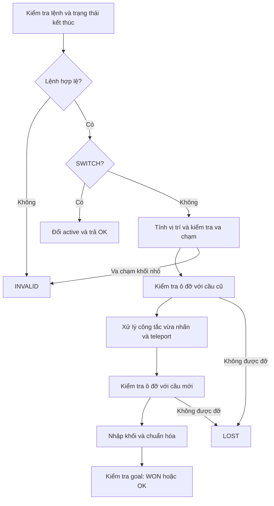

# Engine: trạng thái, luật và API

- Phiên bản 1.0. Chủ trì: thành viên 1. Phối hợp: thành viên 2–5.

## 1. TỌA ĐỘ VÀ HÀNH ĐỘNG

- Tọa độ dùng [row, col], bắt đầu từ 0; row tăng xuống dưới, col tăng sang phải. Ma trận map sẽ có góc trên bên trái là [0;0] và tăng theo quy tắc.
- Hành động và thứ tự sinh hành động là chuỗi: UP, DOWN, LEFT, RIGHT, SWITCH.
- SWITCH chỉ hợp lệ khi đang tách thành 2 khối nhỏ, dùng để chuyển khối đang điều khiển, không di chuyển.


## 2. TRẠNG THÁI

- Dùng cấu trúc bất biến, tách riêng biệt khỏi dữ liệu map:
- State(mode, cells, active, bridges)
- mode: UPRIGHT, HORIZONTAL, VERTICAL hoặc SPLIT.
- cells: tuple các tọa độ (row, col).
- UPRIGHT có 1 ô.
- HORIZONTAL có 2 ô kề nhau cùng hàng.
- VERTICAL có 2 ô kề nhau cùng cột.
- SPLIT có 2 ô khác nhau, không kề nhau, nếu kề sẽ chuyển trạng thái tương ứng.
- Luôn sắp xếp tọa độ theo (row, col).
- active: None khi nguyên khối; 0 hoặc 1 khi SPLIT, chỉ vào cells[0] hoặc cells[1]. Sau khi sắp xếp lại cells, cập nhật active để vẫn chỉ đúng khối đang điều khiển.
- bridges: tuple bool theo thứ tự ID nhóm cầu tăng dần trong map; True là mở, False là đóng.
- Map: dữ liệu cố định trong một lượt tìm kiếm, không nằm trong State.
- Ô dễ vỡ: không cần cờ đã vỡ; khối lớn đứng lên làm thua ngay, không có lượt sau.
- Các quy ước dành riêng cho thuật toán tìm kiếm
- Khóa chống lặp: (mode, cells, active, bridges). Không đưa lịch sử đường đi, thống kê, chi phí g hoặc trạng thái giao diện vào khóa.
- Trạng thái rơi/thua: không đưa vào hàng đợi hoặc tập trạng thái tìm kiếm.
- BFS/DFS: dùng tập khóa đã gặp để chống lặp.
- UCS/A*: lưu thêm best_g riêng; nếu gặp lại cùng khóa qua đường có chi phí thấp hơn, cập nhật và xử lý lại theo thuật toán.


- Ví dụ trạng thái JSON (dùng khi trao đổi với GUI):

```json
{
  "mode": "UPRIGHT",
  "cells": [[1, 1]],
  "active": null,
  "bridges": {"b1": false}
}
```

- Khi đọc JSON, chuyển bridges về tuple theo thứ tự ID đã chốt.


## 3. DI CHUYỂN KHỐI

- Quy tắc dưới đây tính mode và cells dự kiến sau một hành động. Chưa khẳng định nước đi hợp lệ; engine phải kiểm tra các ô đỡ khối và xử lý ô đặc biệt sau đó.
- Khi nguyên khối, gọi (r, c) = cells[0]. Vì cells đã sắp xếp, đây là ô bên trái khi nằm ngang hoặc ô phía trên khi nằm dọc.

### 3.1. UPRIGHT

| Hành động | Mode mới | Cells mới |
| --- | --- | --- |
| `UP` | `VERTICAL` | `((r-2,c), (r-1,c))` |
| `DOWN` | `VERTICAL` | `((r+1,c), (r+2,c))` |
| `LEFT` | `HORIZONTAL` | `((r,c-2), (r,c-1))` |
| `RIGHT` | `HORIZONTAL` | `((r,c+1), (r,c+2))` |

### 3.2. HORIZONTAL

| Hành động | Mode mới | Cells mới |
| --- | --- | --- |
| `UP` | `HORIZONTAL` | `((r-1,c), (r-1,c+1))` |
| `DOWN` | `HORIZONTAL` | `((r+1,c), (r+1,c+1))` |
| `LEFT` | `UPRIGHT` | `((r,c-1),)` |
| `RIGHT` | `UPRIGHT` | `((r,c+2),)` |

### 3.3. VERTICAL

| Hành động | Mode mới | Cells mới |
| --- | --- | --- |
| `UP` | `UPRIGHT` | `((r-1,c),)` |
| `DOWN` | `UPRIGHT` | `((r+2,c),)` |
| `LEFT` | `VERTICAL` | `((r,c-1), (r+1,c-1))` |
| `RIGHT` | `VERTICAL` | `((r,c+1), (r+1,c+1))` |

### 3.4. Hai khối nhỏ — SPLIT

- Với (r, c) = cells[active], chỉ khối đang điều khiển di chuyển:

| Hành động | Tọa độ mới của khối active |
| --- | --- |
| UP | `(r-1, c)` |
| DOWN | `(r+1, c)` |
| LEFT | `(r, c-1)` |
| RIGHT | `(r, c+1)` |

- Khối còn lại giữ nguyên vị trí.
- Không cho phép di chuyển vào ô đang chứa khối còn lại.
- Sau di chuyển, sắp xếp lại cells và cập nhật active.
- Nếu hai khối kề nhau theo cạnh, nhập lại:
- Cùng hàng → HORIZONTAL.
- Cùng cột → VERTICAL.
- Đặt active = None.
- Kề nhau theo đường chéo không nhập lại.

### 3.5. Chuyển khối điều khiển — SWITCH

- Chỉ hợp lệ khi mode == SPLIT.
- Giữ nguyên mode, cells và bridges.
- Đổi active = 1 - active.
- Không di chuyển và không kích hoạt lại công tắc trên sàn.
- Lưu ý về cầu: hành động di chuyển có thể kích hoạt công tắc làm thay đổi bridges. Vì vậy, bảng trên chỉ mô tả chuyển động; bridges cuối cùng do bước xử lý công tắc quyết định.


## 4. LUẬT Ô VÀ THỨ TỰ XỬ LÝ MỘT BƯỚC


### 4.1. Khả năng đỡ khối

| Loại ô | Quy tắc |
| --- | --- |
| floor | Đỡ mọi tư thế và khối nhỏ. |
| void / ngoài map | Bất kỳ phần nào nằm trên đó đều gây thua. |
| goal | Đỡ khối nằm/nhỏ; nguyên khối UPRIGHT mới thắng. |
| fragile | Đỡ khối nằm/nhỏ; nguyên khối UPRIGHT gây thua. |
| bridge | Mở: như floor. Đóng: như void. |
| soft / heavy / split | Đỡ như floor; xử lý hiệu ứng riêng. |

### 4.2. Kết quả của một hành động

- INVALID: hành động không được phép, như SWITCH khi chưa tách hoặc khối nhỏ đi vào ô của khối còn lại. Giữ nguyên trạng thái.
- LOST: hành động làm khối rơi hoặc đứng trên ô dễ vỡ. Không có trạng thái kế tiếp để solver tìm kiếm.
- WON: khối lớn đứng trên ô đích.
- OK: có trạng thái kế tiếp hợp lệ và chưa thắng.
- Chỉ nhận hành động khi game đang chơi. Sau WON hoặc LOST, GUI phải restart hoặc nạp màn để tiếp tục.

### 4.3. Thứ tự xử lý

- Kiểm tra hành động: tên phải thuộc tập hành động đã quy định; SWITCH chỉ dùng khi SPLIT. Nếu sai, trả INVALID.
- Xử lý chuyển động:
- Với SWITCH: đổi active, trả OK ngay.
- Với hướng di chuyển: tính vị trí dự kiến.
- Nếu khối nhỏ đi vào ô của khối còn lại, trả INVALID.
- Kiểm tra ô đỡ tại vị trí dự kiến, dùng trạng thái cầu trước bước đi. Nếu không được đỡ, trả LOST.
- Xác định các công tắc vừa được nhấn: so sánh trạng thái trước bước đi với vị trí dự kiến, trước dịch chuyển và nhập khối.
- Xử lý các công tắc vừa được nhấn theo ID tăng dần:
- Áp dụng hiệu ứng cầu theo thứ tự đó.
- Nếu kích hoạt split, thay khối lớn bằng hai khối nhỏ tại destinations.
- Kiểm tra lại ô đỡ bằng trạng thái cầu mới và vị trí sau dịch chuyển. Nếu không được đỡ, trả LOST.
- Nhập khối nếu cần: hai khối nhỏ kề nhau theo cạnh nhập thành HORIZONTAL hoặc VERTICAL, đặt active = None.
- Chuẩn hóa trạng thái: sắp xếp cells; nếu vẫn SPLIT, cập nhật active để giữ đúng khối đang điều khiển.
- Kiểm tra thắng: nếu UPRIGHT trên goal, trả WON; còn lại trả OK.
- Quy ước chính thức: khi vừa tách, điều khiển khối tại destinations[active_destination]. Sau khi sắp xếp cells, cập nhật active để vẫn chỉ vào khối đó.

### 4.4. Quy tắc kích hoạt công tắc

- Một công tắc được kích hoạt khi:
- not pressed_before and pressed_after_move
- Trong đó:
- pressed_before: xác định từ trạng thái hoàn tất trước bước đi.
- pressed_after_move: xác định sau chuyển động, trước dịch chuyển hoặc nhập khối.
- soft được nhấn khi ít nhất một ô khối chiếm trùng ô công tắc.
- heavy và split được nhấn khi khối lớn UPRIGHT trên ô công tắc.
- Hệ quả:
- Vẫn đè soft qua hai lượt liên tiếp → không kích hoạt lại.
- Khối nằm chuyển sang đứng trên heavy → kích hoạt, vì trước đó heavy chưa được nhấn.
- Muốn kích hoạt lại phải ngừng nhấn rồi nhấn lại.
- SWITCH không thay đổi trạng thái nhấn, nên không kích hoạt công tắc.
- Không cần lưu tập công tắc đang nhấn trong State: có thể tính từ mode, cells và map.

### 4.5. Hiệu ứng cầu và xử lý đồng thời

- toggle: đảo trạng thái mỗi nhóm cầu liên kết.
- permanent: đặt mỗi nhóm cầu liên kết về giá trị open được khai báo. Những lần kích hoạt sau tiếp tục đặt cùng giá trị; không cần cờ “đã kích hoạt”.
- Nếu nhiều công tắc cùng kích hoạt, xử lý theo ID tăng dần.
- Nếu chúng tác động lên cùng nhóm cầu, áp dụng tuần tự; không gộp hoặc bỏ hiệu ứng trùng nhau.
- Ví dụ cầu đang đóng: công tắc ID 1 đặt mở, ID 2 đảo trạng thái → cuối bước cầu đóng.

### 4.6. Dịch chuyển, nhập khối và trạng thái đầu

- Không kích hoạt thêm công tắc do dịch chuyển hoặc nhập khối trong cùng bước.
- Nếu trạng thái hoàn tất đang nhấn một công tắc, lượt tiếp theo coi nó là đã được nhấn. Nó chỉ kích hoạt sau khi được thả rồi nhấn lại.
- destinations của split phải gồm hai ô floor khác nhau, không kề nhau theo cạnh.
- SWITCH chỉ đổi điều khiển, không làm nhập khối.
- Khối bắt đầu đứng trên floor; không tự kích hoạt công tắc lúc nạp màn.
- Với công tắc chỉ chiếm một ô và hai khối không được chồng nhau, không có trường hợp hai khối cùng đè một soft.


## 6. API ENGINE DÙNG CHUNG

```python
# Đọc và kiểm tra JSON; dữ liệu sai ném ValueError kèm lý do.
load_map(path: str) -> GameMap

# Khối UPRIGHT tại start, active=None, cầu theo initial_open.
initial_state(game_map: GameMap) -> State

# Trả (mode, cells, active, bridges).
state_key(state: State) -> tuple

# True khi nguyên khối UPRIGHT trên goal.
is_goal(game_map: GameMap, state: State) -> bool


# Thực hiện một hành động theo luật và thứ tự xử lý đã thống nhất.
transition(game_map: GameMap, state: State,
           action: str) -> TransitionResult

# Sinh bước hợp lệ theo UP, DOWN, LEFT, RIGHT, SWITCH.
successors(game_map: GameMap, state: State) -> list[Successor]

# Tính chi phí bước OK/WON theo hàm chi phí dùng chung.
step_cost(game_map: GameMap, state: State,
          action: str, next_state: State) -> int
```

- TransitionResult gồm:
- status: OK | WON | LOST | INVALID.
- next_state: State nếu OK/WON; None nếu LOST/INVALID.
- reason: None nếu OK/WON; mã nguyên nhân nếu LOST/INVALID:
- UNKNOWN_ACTION, SWITCH_REQUIRES_SPLIT, ALREADY_WON,
- OUT_OF_BOUNDS, VOID, CLOSED_BRIDGE, FRAGILE_UPRIGHT, CUBE_COLLISION.
- events: danh sách sự kiện có cấu trúc, theo thứ tự xảy ra: kích hoạt công tắc, đổi cầu, tách/nhập khối.
- Quy ước:
- INVALID: lệnh không được phép; GUI giữ trạng thái cũ, phát tiếng báo.
- LOST: bước gây thua; GUI hiển thị thua và chặn hành động đến khi restart.
- Trạng thái đã thắng nhận lệnh → INVALID/ALREADY_WON.
- Successor gồm action, state, cost; chỉ nhận kết quả OK/WON.
- successors gọi transition, bỏ LOST/INVALID; trạng thái đích trả [].
- Engine không phụ thuộc Pygame và không sửa state/map đầu vào.
- GUI và solver dùng chung transition, không triển khai luật riêng.

## Hợp đồng events

- `events` là mảng object theo thứ tự xử lý; GUI không suy ra lại luật từ sự kiện.

| type | Các trường bổ sung |
| --- | --- |
| SWITCH_ACTIVATED | switch_id |
| BRIDGE_CHANGED | bridge_id, before (bool), after (bool) |
| BLOCK_SPLIT | cells (tọa độ đã sắp xếp), active |
| BLOCK_MERGED | mode, cells |

- Chỉ phát BRIDGE_CHANGED khi giá trị thực sự đổi. Khi LOST, giữ các events
- đã xảy ra trước lúc phát hiện thua; không dùng chúng làm successor.
- Nếu nhiều ô cùng gây thua, xét tọa độ theo thứ tự đã sắp xếp; trên mỗi ô
- ưu tiên OUT_OF_BOUNDS, VOID, CLOSED_BRIDGE, FRAGILE_UPRIGHT.

## Checklist nghiệm thu thiết kế và triển khai sau đó

- [ ] State bất biến, cells chuẩn hóa và active giữ đúng khối.
- [ ] Kiểm thử đủ 12 chuyển động nguyên khối và 4 chuyển động khối nhỏ.
- [ ] SWITCH, va chạm hai khối, nhập theo cạnh và không nhập theo chéo.
- [ ] Ô đỡ trước/sau đổi cầu; công tắc theo cạnh nhấn và thứ tự ID.
- [ ] GUI/solver cùng gọi transition; map/state đầu vào không bị sửa.
- [ ] Round-trip JSON giữ nguyên state_key.

## Luồng chuyển trạng thái



## API snapshot và bàn giao triển khai nâng cao

- `validate_state(game_map, state)` xác thực số cờ cầu, hình học và ô đỡ của snapshot sống; sai dữ liệu ném ValueError.
- `state_to_dict(game_map, state)` và `state_from_dict(game_map, data)` đổi qua lại JSON gồm đúng mode/cells/active/bridges.
- `GameMap.bridge_ids` là tuple ID sắp từ điển; State.bridges theo đúng thứ tự đó.
- GUI gọi cùng transition; src/solvers/solve.py điều phối bốn solver với cùng successors và cost.
- Dùng Tab đổi khối trong GUI để tránh trùng Space điều khiển replay.
